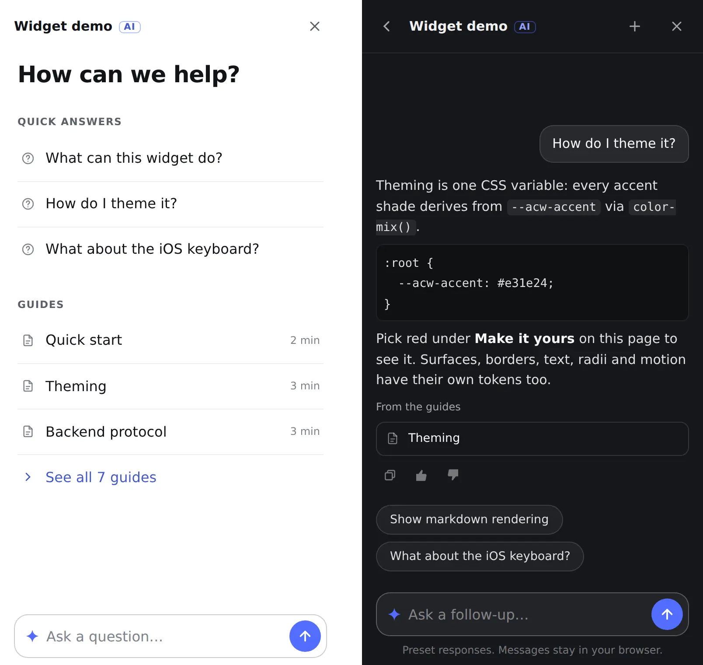

# astro-chat-widget

A chat panel for [Astro](https://astro.build) sites: quick answers, guides and streamed answers
from your AI backend.

[](https://www.npmjs.com/package/astro-chat-widget)
[](https://github.com/eeegoloauq/astro-chat-widget/actions/workflows/ci.yml)
[](LICENSE)



- Opens on a home screen with quick answers, guides and a field to ask.
- Streams markdown answers from your backend over SSE, with links to their sources.
- Answers known questions in the browser, without a backend call.
- Follows light and dark mode; one CSS variable sets your brand color.
- Keeps the composer above the iOS keyboard on phones.

[Live demo](https://eeegoloauq.github.io/astro-chat-widget/)

## Install

```sh
npm install astro-chat-widget
```

Needs Astro 4 or later. The package ships TypeScript source, which your Astro build compiles.

## Usage

```astro
---
import { AIChat } from 'astro-chat-widget'
---
<AIChat
  endpoint="/api/chat"
  contactUrl="/contact"
  quickReplies={[{ text: 'Delivery options', answer: 'Courier **tomorrow**.' }]}
  articles={[{ title: 'Shipping and returns', href: '/help/shipping', minutes: 3 }]}
/>
```

Your endpoint receives `POST { sessionId, message, timestamp, lang }` and replies with
`text/event-stream`:

```
data: {"chunk": "Markdown text"}
data: {"done": true, "sources": [{"title": "Shipping", "href": "/help/shipping"}]}
```

| Prop | |
|---|---|
| `endpoint` | Chat endpoint (required) |
| `quickReplies` | Questions on the home screen; one with `answer` is answered in the browser |
| `articles` | Guides on the home screen and in search |
| `contactUrl` | Link offered when the assistant can't help |
| `strings` | Any user-facing text, for other languages |

Set your brand color with `:root { --acw-accent: #e31e24; }`.

[Reference: all props, protocol, events, theming](docs/reference.md) · [Roadmap](ROADMAP.md)

## Development

Node 24, `npm ci`, then `npm run demo` for the playground at `http://localhost:4322` and
`npm run check` for types.

## License

[MIT](LICENSE)
