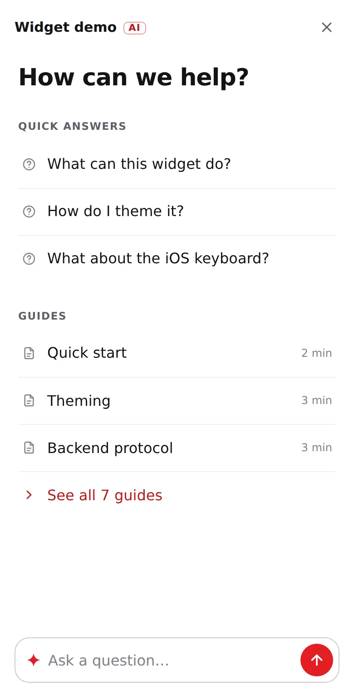

# Reference

Everything `<AIChat />` accepts and emits. The [README](../README.md) covers install and a first
setup.

## Backend protocol

`POST` to `endpoint` with JSON:

```json
{ "sessionId": "uuid", "message": "user text", "timestamp": "ISO-8601", "lang": "en" }
```

Respond with `Content-Type: text/event-stream`:

```
data: {"chunk": "Incremental answer text…"}
data: {"chunk": "…more text"}
data: {"done": true, "suggestions": ["Follow-up question?"], "sources": [{"title": "Shipping", "href": "/help/shipping"}]}
```

- `chunk`: incremental markdown text, any granularity.
- `done`: end of the answer. All fields are optional:
  - `suggestions`: up to 3 are shown as follow-up chips.
  - `sources`: up to 3 `{ title, href }` links shown under the answer. Unsafe schemes are dropped and `linkPrefix` applies.
  - `handoff: true`: show the `contactUrl` link under the answer, e.g. when the backend found nothing.
- `error`: `data: {"error": "..."}` shows the retry note.
- HTTP `429` with a `Retry-After` header pauses the composer with a countdown.

The optional `feedbackEndpoint` receives `POST { sessionId, messageId, rating: 1 | -1, userPrompt, aiResponse, lang, reason, comment: null, timestamp }`. A thumbs down posts once with `reason: null`; if the visitor then picks a reason, a second POST for the same `messageId` carries `reason: 'wrong' | 'off-topic' | 'outdated'`. Upsert by `messageId`.

## Props

| Prop | Type | Default | |
| --- | --- | --- | --- |
| `endpoint` | `string` | — (required) | Chat endpoint. Relative URLs resolve against the page origin. |
| `feedbackEndpoint` | `string` | `''` | Thumbs-rating endpoint. Without it, ratings persist locally only. |
| `lang` | `string` | `'en'` | Sent to the backend with every message. |
| `strings` | `Partial<ChatStrings>` | English | Every user-facing string — see `DEFAULT_STRINGS` export. |
| `quickReplies` | `QuickReply[]` | `[]` | Home "Quick answers" (first three) and composer search. `{ text, emoji? }` sends the text to the backend; add `answer` (markdown) to make it a **local FAQ entry** — answered instantly with no backend call — and `followUps: QuickReply[]` for the chips offered under that answer (an FAQ tree). Pass different ones per page to match the page. |
| `articles` | `Article[]` | `[]` | Home "Guides" (first three, then "See all"), the full guide list and composer search. `{ title, href, minutes?, keywords? }`. Links navigate the page; other origins open in a new tab. |
| `contactUrl` | `string` | `''` | Where "Contact the team" goes (URL or `mailto:`). Shown after `handoff`, on errors and after a thumbs-down reason. Empty hides it. |
| `hotkey` | `boolean` | `false` | Cmd/Ctrl+K opens the panel. Off by default because docs sites often use it for their own search. |
| `linkPrefix` | `{ add, skip? }` | — | Locale prefix for root-relative links in answers, e.g. `{ add: '/en', skip: ['/en', '/ru'] }` turns `/catalog` into `/en/catalog` and leaves `/ru/...` alone. |
| `deepLinkHash` | `string \| false` | `'#chat'` | URL hash that opens the chat (for QR codes / emails). |
| `storageKey` | `string` | `'acw-conversation'` | localStorage key — override to keep conversations when migrating from another widget. |
| `feedbackStorageKey` | `string` | `'acw-feedback'` | localStorage key for the rating map. |
| `maxLength` | `number` | `1000` | Composer character limit. |
| `class` | `string` | — | Extra class on the root element. |

## Opening the chat

Anything with a `data-acw-open` attribute opens the panel (delegated listener, works for content added later):

```html
<button data-acw-open>Ask the AI</button>
```

Programmatic open-and-ask (e.g. FAQ search → hand the query to the assistant):

```js
document.dispatchEvent(new CustomEvent('acw:ask', { detail: { text: 'How do I…?' } }))
```

Deep link: `https://example.com/any-page#chat` opens the chat on load (hash configurable via `deepLinkHash`).

With `hotkey`, Cmd/Ctrl+K opens the panel, or focuses the composer when it is already open.

An open panel travels across page navigations: a sessionStorage flag (`<storageKey>:open`, per tab) reopens it on the next page — desktop only, instantly, without stealing focus, on the screen it was left on. Closing the panel ends that. On phones, following a guide link closes the sheet so the page is visible.

## Analytics events

The widget dispatches CustomEvents on `document` for your analytics:

```js
document.addEventListener('acw:open', (e) => ym(ID, 'reachGoal', 'open-ai-chat')) // e.detail = { restored } — true when the panel reopened itself after a page navigation
document.addEventListener('acw:send', (e) => ym(ID, 'reachGoal', 'send-ai-message')) // e.detail = { text, local? } — local: true for FAQ chips answered without a backend call
document.addEventListener('acw:feedback', (e) => { /* e.detail = { messageId, rating, reason } */ })
document.addEventListener('acw:guide', (e) => { /* e.detail = { href, from: 'home' | 'search' | 'guides' | 'sources' } */ })
document.addEventListener('acw:contact', (e) => { /* e.detail = { href } */ })
```

## Theming

The widget reads `--acw-*` custom properties set on `:root`. The accent variants are derived from
`--acw-accent` with `color-mix()`; surfaces, text, borders and the danger color have their own
tokens with light and dark defaults. Most brands only need:

```css
:root {
  --acw-accent: #e31e24;
}
```

The widget follows the visitor's system theme. If your site has its own theme toggle, set the
scheme with it:

```css
:root { --acw-color-scheme: light; }
:root.dark { --acw-color-scheme: dark; }
```

The panel is solid by default, because text over an unknown page behind glass is hard to read.
For glass on desktop, make the surface translucent and add a blur. It turns solid again when the
visitor asks for reduced transparency; the mobile sheet always stays solid.

```css
:root {
  --acw-surface: light-dark(rgba(255, 255, 255, .7), rgba(22, 23, 28, .74));
  --acw-blur: blur(22px) saturate(1.6);
}
```

The mobile sheet with only the accent override:



Full token list:

| Token | Purpose |
| --- | --- |
| `--acw-accent` | Buttons, FAB, links, selection. The accent variants below default to a `color-mix()` of it. |
| `--acw-accent-hover` / `-soft` / `-strong` / `-disabled` | Hover state · light variant (links, focus rings) · dark end of the FAB gradient · disabled send. |
| `--acw-accent-glow-soft` / `-glow` / `-glow-strong` | FAB shadow at rest / keyboard focus / hover. |
| `--acw-on-accent` | Text/icon color on accent surfaces (default `#fff`). |
| `--acw-color-scheme` | `light`, `dark` or `light dark` (default: follow the system). Picks the light or dark default of every color token. |
| `--acw-danger` | Error-note tint, the FAB unread dot and the delete button. |
| `--acw-surface` | Desktop panel background (opaque by default; translucent for glass). |
| `--acw-surface-solid` | Mobile sheet + scrim background (must be opaque). |
| `--acw-blur` | Desktop panel `backdrop-filter` (default `none`). |
| `--acw-shadow` | Desktop panel `box-shadow`. |
| `--acw-raise` / `--acw-raise-subtle` | Light overlays: user bubble, hovers, inline code / chips, notes. |
| `--acw-input-bg` / `--acw-input-bg-focus` | Composer field. |
| `--acw-code-block-bg` | `<pre>` background. |
| `--acw-scrollbar-thumb` | Messages scrollbar. |
| `--acw-text-strong` / `--acw-text` / `--acw-text-muted` / `--acw-text-placeholder` / `--acw-text-faint` | Text hierarchy. |
| `--acw-border` / `--acw-border-strong` / `--acw-border-subtle` | Border hierarchy. |
| `--acw-font` / `--acw-font-size` / `-sm` / `-xs` | Typography (font defaults to `inherit`). |
| `--acw-space-xs` / `--acw-space-sm` | Spacing rhythm. |
| `--acw-radius-sm` / `-lg` / `-xl` | Corner radii. |
| `--acw-dur-fast` / `--acw-dur-med` / `--acw-ease` / `--acw-ease-spring` | Motion. |
| `--acw-z-fab` / `--acw-z-panel` | Stacking (defaults `5000` / `10001`; the mobile scrim sits at panel − 1). |

## Upgrading from 0.1.2

- The panel opens on a home screen. `greeting` is now its heading instead of a first message, so a long greeting reads as a large title; keep it short.
- The default look is solid and follows the system theme. For the old dark glass panel:

  ```css
  :root {
    --acw-color-scheme: dark;
    --acw-surface: rgba(16, 16, 20, .88);
    --acw-blur: blur(24px) saturate(1.5);
  }
  ```

- The expand button is gone, and with it the `expand` and `collapse` strings. Remove them from `strings` if you set them.
- The chat button no longer pulses.
- Stored conversations load unchanged; their old greeting messages are skipped.

## Host page requirements

- One `<AIChat />` per page, usually in your layout.
- Viewport meta for Android keyboards:

  ```html
  <meta name="viewport" content="width=device-width, initial-scale=1, interactive-widget=resizes-content" />
  ```

  Chrome ≥108 defaults to `resizes-visual` (keyboard overlays the page), which would cover the composer. `resizes-content` makes the layout viewport shrink. iOS ignores this attribute; the widget handles iOS with `visualViewport` tracking.
- The widget uses `color-mix()`, `light-dark()`, `:has()`, `@starting-style` and `transition-behavior: allow-discrete` — current browsers from about 2024. On older browsers the panel still opens and streams; only open/close animations degrade.

## Behaviour

- The panel opens on a home screen: quick answers, guides and a field to ask. Typing searches the quick answers and guides; Enter sends the question to the assistant.
- Answers can link to the pages they came from, and offer a contact link when the backend can't help.
- Light and dark follow the visitor's system or your site's theme toggle. The panel is solid by default; glass is opt-in.
- The shell renders as static HTML; the chat module loads on first interaction, and prefetches when the button is hovered.
- Streaming markdown through an append-only parser, revealed word by word, with auto-scroll that stops when the user scrolls up.
- The dialog opens non-modally: the page behind stays scrollable and interactive, clicking it does not close the chat (Esc does), and an open panel reopens itself on the next page until it is closed.
- On mobile the panel is a `position:fixed` sheet riding the keyboard via `visualViewport`, because iOS Safari clips the `<dialog>` top layer while the keyboard is up (WebKit [#300965](https://bugs.webkit.org/show_bug.cgi?id=300965), [#303167](https://bugs.webkit.org/show_bug.cgi?id=303167)).
- Answers are built with `createElement` only: unsafe URL schemes rejected (in markdown, sources, guides and the contact link), images left without `src` so a prompt-injected backend cannot trigger outbound requests, `noopener` on external links, HTTPS enforced for endpoints in production builds.
- One conversation kept in `localStorage` (30-day expiry, 50-message cap), with thumbs up/down per message and an optional reason after thumbs down. New chat asks before deleting it.
- Rate-limit handling (HTTP 429 + `Retry-After` countdown), retry on failure, and Stop mid-stream that keeps the partial answer.
- The conversation grows upward from the composer; an unread dot lights the button when an answer finishes while the panel is closed.
- Every string is a prop, `prefers-reduced-motion` is respected, and finished answers are announced to screen readers whole rather than word by word.

## Debugging the iOS keyboard

Append `#kbdebug` to the URL on a real device: a monospace readout overlays the panel with live `visualViewport` numbers. Desktop DevTools cannot reproduce the iOS keyboard, so test on a device.
